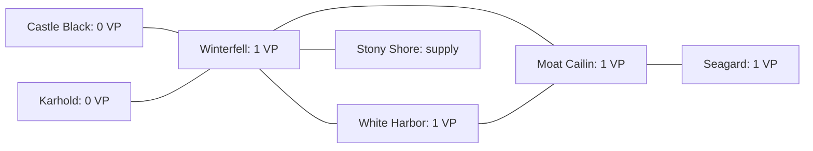

# Why Stark failed to expand: local trace investigation

14 September 2026

Follow-up: [Second- and third-place players](../placed-players-2026-09-14/README.md), including a census of 22 finishes and three additional complete player histories.

**The suspicion is substantially supported: the inspected players make elementary rules errors and fail to turn available map information into useful plans. However, the evidence does not support “the models have no map” or “nobody expanded.”** The clearest failure is a combination of misunderstood rules, poor territory valuation, and repeated safe actions that cannot improve the score. The harness supplies substantial information, but does little to expose the consequences of a proposed action or interrupt an ineffective strategy.

I reviewed three complete Stark decision histories: 95 model runs, including 94 successful runs and one failed run. I recovered and hash-verified the original observation inputs for all 94 successful runs. The two GPT-OSS cases contain recorded reasoning; the Qwen case does not. Statements about Qwen's motivation are therefore limited to its one explicit strategy note, rather than inferred private thoughts.

The findings below use references such as **A03**. These identify entries in [evidence.json](evidence.json), which records full run IDs, SQLite history/message IDs, input hashes, recorded reasoning, requested and accepted actions, relevant observation fields, and corroborating game-log entries. [extract_evidence.py](extract_evidence.py) reproduces the evidence from the local databases without contacting a provider.

## What the results actually show

The local artifact census found **11 completed games configured for the normal 10-round maximum and seven-point victory target. All 11 ended in round 10.** Shortened protocol and model smoke tests were excluded by their saved game configuration, not by their outcome.

Several players did expand. In the five-game `gpt-oss-120b-house-test-b4279fb` experiment, the winners finished with 5, 5, 5, 4, and 5 victory points; their land counts were 8, 7, 6, 7, and 9. Stark's final land counts were 3, 5, 4, 4, and 4. A separate mixed-model game had a Stark winner with five victory points.

Thus, reaching round 10 is a reason to inspect the quality of play, but it does not establish that expansion was impossible. Nor does a final land count show whether a player captured territory and later abandoned it.

| Case | Local evaluation / game / attempt | Stark model | Finish | Initial → final VP / land |
| --- | --- | --- | --- | --- |
| **A: main case** | `gpt-oss-120b-house-test-b4279fb / 01 / 01` | `openai/gpt-oss-120b` | 5th | 2 → 1 VP; 2 → 3 land |
| **B: corroborating case** | `gpt-oss-120b-house-test-4747688 / 01 / 01` | `openai/gpt-oss-120b` | 5th | 2 → 1 VP; 2 → 2 land |
| **C: prolonged stagnation** | `model-tournament-ebae98a / 03 / 02` | `qwen/qwen3-235b-a22b-2507` | 5th | 2 → 2 VP; 2 → 2 land |

These are different saved games and potentially different runtime revisions. They corroborate failure modes; they are not a controlled comparison of models or prompts.

## Case A: Stark moved north, gave away White Harbor, and stopped expanding

Stark started with a footman and knight in Winterfell, a footman in White Harbor, and a ship in the Shivering Sea. Winterfell and White Harbor provided its two victory points.

| Round | Actual decisions and consequences |
| --- | --- |
| 1 | Marched both Winterfell units to Castle Black; moved the White Harbor footman to Karhold without leaving a control token; moved the ship to the Narrow Sea. Land increased from two to three, but VP fell from two to one. |
| 2 | Bid all eight available power tokens in a Wildling attack while reasoning about influence-track positions. Received a footman-upgrade reward. Placed defense on the northern land units and Consolidate Power on the sea. |
| 3 | Mustered a footman in Winterfell and a ship in the Bay of Ice. Placed defense/support on land and Consolidate Power on both seas. |
| 4–6 | Repeated substantially the same defensive/support arrangement. No March orders in any of these rounds. |
| 7 | Upgraded Winterfell's footman to a knight. Finally assigned a March there, but moved the knight to already-owned Castle Black instead of an available castle. |
| 8 | Lost both ships to a Wildling penalty; placed support on Castle Black and Karhold. |
| 9 | Placed defense on both remaining occupied land regions. |
| 10 | Placed defense on Castle Black and Consolidate Power on Karhold. Finished fifth with Winterfell, Castle Black, and Karhold. |

All 25 Stark runs completed. There were **only four accepted marches in the entire game**, three in round 1 and one in round 7. **Eight of ten planning phases contained no March order.** The game log contains no Stark combat. This player was not repeatedly trying to conquer territory and being defeated by opponents.

### 1. It reversed the control-token rule and voluntarily lost a castle

In **A03**, immediately before leaving White Harbor, the model wrote:

> “If we leave token, we lose control of white-harbor. Better not leave token.”

It submitted `leave_power_token: false`. The game log records the choice, and the next original model input shows Stark's VP falling from two to one.

The observation explicitly permitted leaving a token (`canLeavePowerToken: true`), and Stark had five power tokens. The system instructions also said to preserve control with power tokens when vacating valuable land. This was an incorrect interpretation of information already available, not a missing tool capability.

**Concrete missed alternative:** the same White Harbor footman could have marched to empty Moat Cailin, which was listed as reachable with no combat, while leaving a token in White Harbor. That would have preserved White Harbor and gained a new castle immediately. Moving a singleton to another empty region would not create a new multi-unit army. This is a local counterfactual supported by the saved state; subsequent opponent responses were not simulated.

### 2. It concentrated strength in regions that did not advance its castle objective

The map in the original input correctly identifies:

| Region | VP if controlled | Supply icons | Strategic relevance in this position |
| --- | ---: | ---: | --- |
| Winterfell | 1 | 1 | Home stronghold; land junction connecting the north to expansion routes |
| White Harbor | 1 | 0 | Starting castle that Stark abandoned |
| Moat Cailin | 1 | 0 | Available southern castle in round 1; connects onward to the Riverlands |
| Castle Black | 0 | 0 | Northern crown region; a power source if used accordingly |
| Karhold | 0 | 0 | Northern crown region; another power source |
| The Stony Shore | 0 | 1 | Nearby supply region |

Castle Black's name does not make it a scoring castle: its supplied `castleLevel` is zero. Winterfell's `castleLevel: 2` means a stronghold, not two victory points.

Stark occupied the northern crown regions but mostly assigned them support or defense, leaving both their income and their units underused. Later reasoning repeatedly treated “no adjacent enemy” as a reason not to march. That overlooks neutral expansion and repositioning through friendly territory.

The following is a **partial land-adjacency graph**, extracted from the saved map; it omits sea transport and other edges:



This is a failure to plan movement toward useful locations, despite having the graph. After moving north, the player could plan a route back through Winterfell rather than conclude there was nothing to do.

### 3. It used supply as an incorrect reason to remain stationary

In **A15**, round 5:

> “Expanding may exceed supply. Better defend.”

The position had two knights together at Castle Black and single units elsewhere. Moving Winterfell's single footman into an empty region would not create another army. The rule concerns the sizes and number of multi-unit armies, not how many territories a house may occupy.

In **A08**, the model also treated recruitment costs as “supply tokens” and reasoned that supply level one prevented recruiting a knight costing two. These are separate concepts: mustering points purchase units; the supply track limits army configurations. The mustering observation supplied `allowedArmySizes: [3, 2]`, an explanation that single units do not use an army slot, and separate unit costs. The model did not combine these correctly.

### 4. It repeatedly tried to earn power from the open sea

The model repeatedly described Consolidate Power on the Bay of Ice or Narrow Sea as a way to gain tokens. The game log records **ten resolved Stark sea-consolidation orders, all yielding zero tokens**. Another such order on the Narrow Sea was raided in round 6, costing Stark a power token and benefiting Baratheon.

These orders were legal, but economically ineffective. The existing generic instruction that consolidation “builds bidding reserves” omitted the sea exception at the point of planning. The rules and the engine both specify that Consolidate Power in an open sea area produces nothing. Ports have different rules.

This distinguishes a rules misunderstanding from intentional use of a harmless order as a decoy: the recorded reasoning expected income.

### 5. It failed to execute its own expansion idea when a clear opportunity appeared

In round 7 planning (**A18**), the model considered recapturing empty White Harbor. At march resolution (**A19**), its supplied destinations included:

- White Harbor: no controller, no garrison, no combat.
- Moat Cailin: Greyjoy control, no garrison, no combat.
- Flint's Finger: Greyjoy control, no garrison, no combat.

Instead it wrote:

> “Likely we want to move to a safe region, perhaps castle-black (own) to consolidate forces.”

It moved the Winterfell knight into Castle Black. The already-owned home region remained Stark's, but the move gained no land or VP. Moving that knight into White Harbor would have immediately recovered a scoring region without combat and without adding an army slot.

The problem here is not an unavailable route. The useful destinations were explicit in both action guidance and the tool's destination enum. The model preferred reinforcement without connecting it to a subsequent objective.

### 6. It confused the purpose of bidding and did not seek clarification

In **A05**, the model spent eight tokens while reasoning that a bid would improve its position on all three influence tracks. The input's `statePath` was `ingame → westeros → wildlings-attack → bidding`. It was a contribution to the Night's Watch, not a Clash of Kings track auction. The bid happened to earn a Wildling-card reward; that does not make the explanation correct.

Later it again reasoned about moving up tracks during Wildling bidding and even suggested that each token might move it one position (**A20**).

**Across all 25 decisions, it never called the available rules oracle, never recalled a previous state, and never wrote a strategy note.** Its `modelPlan` remained empty. In round 6 (**A16**), its entire recorded rationale was effectively “Same assignments likely fine.” The memory system preserved action history and generic objectives, but no model-authored plan or corrective lesson emerged.

## Case B: more movement, but progress repeatedly undone

This earlier GPT-OSS Stark game finished with two land areas, but it did capture new areas during play. Reading only the final count would miss the central problem.

Three decisions are particularly revealing:

**Round 6, B18: trying to overfill Castle Black.** The model twice tried to move both White Harbor footmen into Castle Black, where two units already stood. That would create a four-unit army at supply level one, whose largest permitted army was three. The server rejected both attempts, but the tool returned only a generic “authoritative state did not reflect the action” error. The model guessed at causes, then moved one footman successfully. It had access to other expansion destinations but chose reinforcement. This is both a model rules error and a historical error-feedback deficiency.

**Round 7, B21: abandoning White Harbor again.** The model moved its last White Harbor knight to Winterfell and wrote, “White harbor has no power token currently; leaving not needed.” It declined a permitted control token and lost the castle. This independently reproduces the ownership misunderstanding from Case A.

**Rounds 9–10, B31–B36: winning a castle, then giving it away.** Stark attacked Moat Cailin with two knights and won, 8 combat strength to 5. In the following round, its planning reasoning incorrectly claimed “White Harbor has no castle level,” although the static map still identified it as a castle. It then moved both knights back to Winterfell because that seemed safest, abandoning Moat Cailin without a token.

At **B36**, the actual input listed White Harbor and Seagard as reachable, empty, and not requiring combat. A simple alternative was to move **one** knight into White Harbor and leave the other in Moat Cailin. That would preserve Moat Cailin, recover White Harbor, and reduce rather than increase the number of multi-unit armies. At the decision boundary, this would produce three Stark VP rather than the one left by the chosen withdrawal. Future enemy actions remain untested.

There was also a tool-design problem in **B15**: the model requested Consolidate Power in four regions while only two non-starred tokens were available. The allocator preserved the higher-priority requests for the Bay of Ice and Castle Black and substituted defense at White Harbor and the Shivering Sea. Consequently, one scarce income order went to a sea area that could earn nothing, while useful land income was displaced. The model-facing completion returned acceptance, rather than a clear explanation of this strategic consequence. The accepted-action record does contain the actual allocation.

## Case C: Qwen recovered its starting position, then declined to rebuild

This case most closely matches the appearance of “never expanding” in a results overview, but it initially acted competently in some respects:

- In round 1 it marched White Harbor's footman to Moat Cailin, then defended successfully against Greyjoy using Robb Stark. It nevertheless left White Harbor uncontrolled, exchanging one castle for another rather than adding one.
- In round 2, a Wildling defeat required Stark to destroy two units. It selected Winterfell's footman and knight. It subsequently moved the remaining land unit from Moat Cailin back to White Harbor, again without retaining the vacated castle.
- In rounds **3, 4, 7, and 8**, it explicitly called `skip_mustering`.
- In every planning phase from **round 3 through round 10**, it selected the identical pair: defense at White Harbor and defense in the Shivering Sea. It never marched again.

This was not a lack of legal recruitment options. In **C17**, the original input offered two mustering points at empty, Stark-controlled Winterfell, one at White Harbor, available pieces, and supply capacity. It could have recruited a knight at Winterfell and used White Harbor's point to upgrade its footman, without creating a multi-unit army. Those opportunities were declined.

Qwen's one strategy note from round 1 remained unchanged through round 10. It promised expansion and described “secur[ing] northern supply by consolidating in Winterfell,” which itself muddles supply and power. However, there is **no recorded reasoning text explaining the later skips**. The evidence establishes prolonged defensive repetition and failure to rebuild; it does not establish whether Qwen specifically believed it lacked tokens, supply, or a useful route.

One run failed by calling a tool unavailable in the current phase; a retry recovered. That isolated failure does not explain eight subsequent rounds of accepted defensive orders.

## What the context and tools contributed

| Hypothesis | Finding | Assessment |
| --- | --- | --- |
| No map or adjacency information | Original inputs contain all 58 map regions, types, castle levels, resource icons, and neighbours. March decisions also contain reachable destinations. | Not supported as a literal absence. |
| Weak spatial understanding | Models repeatedly favor the far north, confuse region value, overlook neutral castles, and fail to plan through friendly territory. | Strongly supported by the GPT-OSS reasoning. |
| Insufficient rules understanding | Wrong control-token effect; supply confused with spending currency; sea consolidation expected to earn income; Wildling bidding treated as track bidding. | Directly supported. |
| Expansion tools fundamentally unavailable | Models can march, muster, retain control, and fight. Case B wins an attack; Case C wins a defense. | Not supported. |
| Information is poorly organized for decisions | Static map, sparse dynamic board, legal destinations, and strategic synopsis are separate. Reachable targets lack joined castle/resource values. Planning lacks a concrete movement/outcome preview. | Supported by the input structure; causal improvement needs testing. |
| Accepted actions imply meaningful play | Legally accepted defense loops, zero-income sea orders, skipped musters, and abandonment all advance the game. | Clearly false. |
| Durable memory guarantees strategy | GPT-OSS never writes a plan in Cases A/B; Qwen's plan stays stale. Generic objectives and action summaries do not enforce execution or learning. | Clearly false in these cases. |

The context is already substantial. **A19's serialized observation message alone is 45,878 characters**, before tool schemas, instructions, and selected history. Adding more undifferentiated context is not the first change I would make.

One likely presentation problem is that the dynamic `board` excludes empty regions, while the static `map` includes them. Empty expansion opportunities therefore require a join across two representations, plus the march guidance. The trace proves the facts were available; it does not prove that this representation caused every oversight.

The rules oracle is optional and was unused by all three inspected Stark players, despite repeated uncertainty. An oracle cannot correct misconceptions the player never asks about.

## A separate audit defect: saved run observations can change after the decision

**61 of the 94 hash-verified successful runs had differences between the original input and the observation later stored in `agent_runs`.** The per-case counts were 17/25, 24/37, and 20/32.

For example, in **A19**, the later run record places knight **45** in both Winterfell and Castle Black. The original SDK input correctly places it only in Winterfell. Its message is SQLite `agent_messages.id = 609`; its input SHA-256 is:

`fd0a423e657058abc4db913c1ea7bf00fd812d6356e1cd48efbf582de6c6712e`

The historical observation builder keeps references to mutable unit lists and other nested state. The run is persisted after gameplay has changed those objects. The original serialized SDK message and pre-decision history remain useful for recovery.

**This is an audit/storage defect, not evidence that the model saw duplicate units.** It can mislead anyone inspecting only a run's saved observation. The report uses the hash-matched original inputs for successful runs. The single failed Qwen run has no matching persisted input message and is explicitly marked unverified in the evidence.

Relevant implementation: [observation construction](../../../src/raven_harness/harness/observation.py), [run orchestration](../../../src/raven_harness/manager.py), and [run persistence](../../../src/raven_harness/agent_store.py). The same reference-sharing pattern is present in the inspected current checkout; this investigation does not change it.

## Changes I would prioritize before another tournament

1. **Freeze and preserve the exact decision input.** Store an immutable observation at request time, together with its serialized content and hash. Present pre-action and post-action state separately. This makes further evaluation trustworthy.

2. **Show concrete movement outcomes before planning and execution.** Join each reachable target with controller, castle VP, resources, transport path, units, and combat status. For each proposed march, calculate immediate land/VP changes and whether the source loses control. State explicitly: “White Harbor becomes uncontrolled; −1 VP unless you retain a unit or leave a token.” Display legal army-size consequences, not only a destination enum.

3. **Put the relevant rule next to the decision.** Explain that sea consolidation yields zero; mustering points are not supply or power tokens; singletons use no army slot; and Wildling bids fund defense rather than an influence track. Give bids an explicit purpose and selected-unit actions an explicit consequence such as destruction or upgrade. Keep the full oracle as a supplement.

4. **Expose ineffective or changed actions.** Preview order allocation and explain substitutions. Report exactly which muster/march groups were rejected or omitted and why. Distinguish an accepted action that produces no progress from a successfully executed strategic intent. The older generic supply rejection in B18 should not be the model's only feedback; later code already changes some supply handling, so verify the present path before modifying it.

5. **Make planning measurable.** Ask for a specific target, required orders, expected next-round territory, and a condition for revising the plan. At the next decision, compare the expected result with the actual one. Flag consecutive no-March rounds, unused mustering capacity, and repeated zero-yield orders. A warning should trigger reconsideration, not force every player to attack regardless of circumstances.

6. **Test these failures directly before paying for full games.** Replay the exact A03, A15, A19, B18, B36, and C17 decision inputs with controlled context/tool variants. Measure correct control retention, supply reasoning, useful movement, and use of available recruitment. Then test several rounds for retained castles, net land gain, productive orders, and plan execution. Keep model, seed, and inference settings fixed when comparing variants.

The strongest current diagnosis is **rules misunderstandings plus ineffective planning, enabled by a harness that accepts legal inactivity and leaves action consequences implicit**. Better map presentation is warranted, but the recorded failures are broader than spatial awareness, and several occurred despite explicit legal alternatives already being present.

## Evidence and reproduction

The evidence package includes all 95 inspected runs rather than only the quoted mistakes. Reasoning passages are provider-returned trace text, not a guarantee of the model's complete internal process. Counts of model tool calls include retries; counts of accepted actions do not.

The rule checks use the locally prepared official-rule text in [data/rules.json](../../../data/rules.json): sections `supply-and-mustering`, `planning-and-orders`, `action-orders-and-victory`, `ship-transport-control-power`, `wildlings`, and `faq-movement-supply-ports`. Sea consolidation is independently corroborated by ten zero-token game-log results and the engine's [income calculation](../../../swords-and-ravens/agot-bg-game-server/src/common/ingame-game-state/action-game-state/resolve-consolidate-power-game-state/resolve-single-consolidate-power-game-state/ResolveSingleConsolidatePowerGameState.ts).

From the repository root:

```bash
python3 docs/analysis/stark-expansion-2026-09-14/extract_evidence.py
```

This reads the three closed databases with SQLite `mode=ro&immutable=1`, refuses nonempty WAL files, verifies the key findings, and regenerates `evidence.json`. It does not read authentication columns into the output, contact providers, or alter game state. No paid reruns or counterfactual games were performed.

Key source coordinates:

| Reference | Run ID | History row | SDK message row |
| --- | --- | ---: | ---: |
| A03: White Harbor abandonment | `a8d4a87b-ead8-4e12-a6a2-b8154f050bc2` | 14 | 56 |
| A15: expansion/supply misconception | `f2da7d80-f31f-4571-82df-57e1e20c4519` | 97 | 407 |
| A19: knight returns north | `af30a98d-e3bc-4fd3-afea-78dc20db8c69` | 146 | 609 |
| B18: generic rejection of oversized army | `6bbd9112-aaba-4b6e-be7a-279f7e7786bd` | 124 | 556 |
| B36: abandonment after winning Moat Cailin | `1be3bc72-ccd8-47a5-8f90-7487dd80fb2a` | 269 | 1185 |

Database paths are recorded per case in `evidence.json`; the source result and game files also have recorded SHA-256 hashes. The report makes no claim that these selected losers represent every model, or that any untested proposed change will fix tournament performance.
